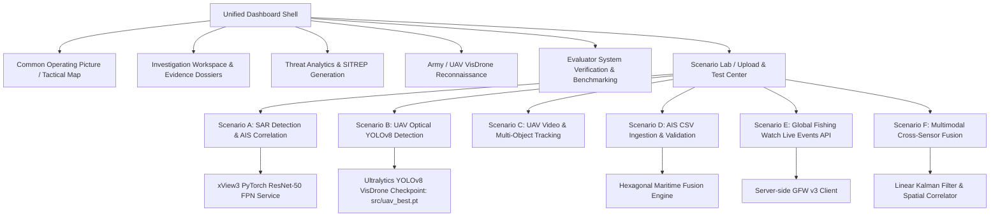

# NAVAL SENTINEL — MARITIME THREAT DETECTION & MULTIMODAL FUSION DASHBOARD
### Sovereign AI Challenge · Defense Systems Architecture & Evaluation Platform

Naval Sentinel is an operational Command and Control (C2) maritime threat detection and multi-sensor intelligence platform. Built with a React + TypeScript frontend, Express backend gateway, PyTorch deep learning microservices, and a hexagonal spatial fusion engine, it provides real-time situational awareness across maritime (Navy) and aerial drone (Army/UAV) operational domains.

---

## 1. System Architecture



---

## 2. Scenario Lab & Evaluation Center

Accessible directly from the sidebar navigation (`Scenario Lab`), the evaluation testbench allows evaluators to upload assets, run live model forward passes, validate data feeds, and export forensic evidence bundles:


### Scenario A — SAR Maritime Vessel Detection
- **Target Sensor**: Sentinel-1 SAR synthetic aperture radar (IW GRDH).
- **Accepted Formats**: GeoTIFF (`.tif`, `.tiff`), preprocessed chips (`.png`, `.jpg`).
- **Processing**: Submits SAR backscatter intensity matrices to the AI2 xView3 ResNet-50 FPN model bridge.
- **Correlation**: Spatially and temporally associates detected radar contacts with active AIS transponder positions.
- **Classification**: Strictly categorizes contacts into:
  - `AIS Matched`: Spatial match within distance and time envelopes.
  - `Unmatched SAR Candidate`: High-contrast radar return with no active AIS transponder (dark vessel candidate; never auto-labeled hostile).
  - `Ambiguous Match`: Multiple candidate vessels within tolerance radius.

### Scenario B — UAV / Army Optical Image Detection
- **Target Sensor**: Drone electro-optical (EO/IR) reconnaissance imagery.
- **Accepted Formats**: `.jpg`, `.jpeg`, `.png`, `.tif`.
- **Model Checkpoint**: Fine-tuned Ultralytics YOLOv8 VisDrone checkpoint located at `src/uav_best.pt`.
- **Taxonomy**: 10 VisDrone categories (`pedestrian`, `people`, `bicycle`, `car`, `van`, `truck`, `tricycle`, `awning-tricycle`, `bus`, `motor`).
- **Georeferencing**: Converts pixel coordinates to geodetic coordinates (`GEOREFERENCED`) only when camera altitude, pitch, heading, and gimbal GPS coordinates are present; otherwise flags as `UNREFERENCED`.

### Scenario C — UAV Video Detection & Tracking
- **Target Sensor**: UAV aerial video stream.
- **Accepted Formats**: `.mp4`, `.mov`, `.avi`.
- **Pipeline**: Sequential frame extraction, multi-target detection, and persistent track ID assignment using a spatial IoU / DeepSORT tracking algorithm.
- **Metrics**: Effective throughput (FPS), active track continuity, and per-frame latency.

### Scenario D — AIS CSV / Vessel Track Import
- **Purpose**: Kinematic validation and anomaly detection on historical or real-time vessel records.
- **Accepted Formats**: Standard CSV with header mappings for `timestamp`, `mmsi`, `lat`, `lon`, `sog`, `cog`, `vessel_name`.
- **Validation Engine**:
  - Rejects out-of-range coordinates (`-90 <= lat <= 90`, `-180 <= lon <= 180`).
  - Validates MMSI format (7 to 9 digits, nonzero).
  - Identifies duplicate entries and corrects malformed timestamps.
  - Generates detailed row-level error diagnostic reports.
- **Fusion Integration**: Ingests validated records into the in-memory spatial database, updating the live tactical map and triggering anomaly rules (speed jumps, GNSS spoofing, loitering, and zone intrusions).

### Scenario E — Global Fishing Watch Live API
- **Purpose**: Live external maritime event ingestion.
- **Datasets**:
  - `public-global-encounters-events:latest`
  - `public-global-gaps-events:latest`
  - `public-global-loitering-events:latest`
- **Security & Honest Accounting**:
  - `GFW_API_TOKEN` is maintained strictly server-side and never exposed to the frontend, browser logs, or export bundles.
  - Returns honest `NOT CONFIGURED` when the token is absent; never fabricates fake records under a "Live" label.

### Scenario F — Multimodal Cross-Sensor Fusion
- **Purpose**: Cross-sensor threat correlation across SAR radar, UAV optical detections, AIS kinematics, and GFW events.
- **Configurable Tolerances**: Spatial correlation radius (meters) and temporal window (minutes).
- **Output**: Composite explainable threat alerts with transparent evidence provenance, score breakdown, and ambiguity ratings.

---

## 3. Evaluator Evidence Export

Evaluators can download reproducible evidence bundles directly from Scenario Lab:
1. **Export JSON**: Full structured job record with timing metrics, configuration parameters, and detection coordinates.
2. **Export CSV**: Tabular metrics report for automated ingestion.
3. **Export SITREP (.MD)**: Formatted tactical operational report with model checkpoints and performance latencies.

All exports are cryptographically sanitized to strip sensitive environment secrets and API keys.

---

## 4. Automated Test Suite

Naval Sentinel includes 58 automated integration and benchmark assertions:

```bash
# 1. Run Scenario Lab end-to-end tests (35 assertions)
node node_modules/tsx/dist/cli.mjs test/scenario_lab.test.ts

# 2. Run Kalman Filter and System Verification tests (23 assertions)
node node_modules/tsx/dist/cli.mjs test/kalman_and_verification.test.ts
```

### Test Coverage Breakdown:
- **Scenario Cards Configuration**: 6/6 registered cards and readiness status.
- **AIS CSV Validation**: Row-level parsing, duplicate detection, bad coordinate rejection, FusionEngine ingestion.
- **Scenario A (SAR)**: Radar detection, AIS correlation categorization (`Matched`, `Unmatched`, `Ambiguous`).
- **Scenario B (UAV Image)**: YOLOv8 10-class taxonomy, confidence thresholds, georeferenced vs unreferenced states.
- **Scenario C (UAV Video)**: Frame extraction, tracking continuity, FPS recording.
- **Scenario E (GFW)**: Honest `NOT CONFIGURED` reporting and secret isolation.
- **Scenario F (Fusion)**: Cross-modality threat correlation.
- **Evidence Exports**: JSON, CSV, Markdown formatting and credential redaction.
- **Linear Kalman Filter**: State vector `[x, y, vx, vy]`, covariance updates, track smoothing, extrapolation.

---

## 5. Getting Started

### Prerequisites
- Node.js (v18+)
- Python (3.8+) with PyTorch and Ultralytics installed

### Environment Configuration
Create a `.env` or `.env.local` file:
```env
# Optional Gemini API Key for NL query parsing and executive briefings
GEMINI_API_KEY="your-gemini-key"

# Optional Global Fishing Watch token for live API events
GFW_API_TOKEN="your-gfw-token"

# Port (defaults to 3000)
PORT=3000
```

### Installation & Launch
```bash
# Install dependencies
npm install

# Start development server (serves frontend & backend on port 3000)
npm run dev

# Build production bundle
npm run build
```
Access the dashboard at `http://localhost:3000/`.
